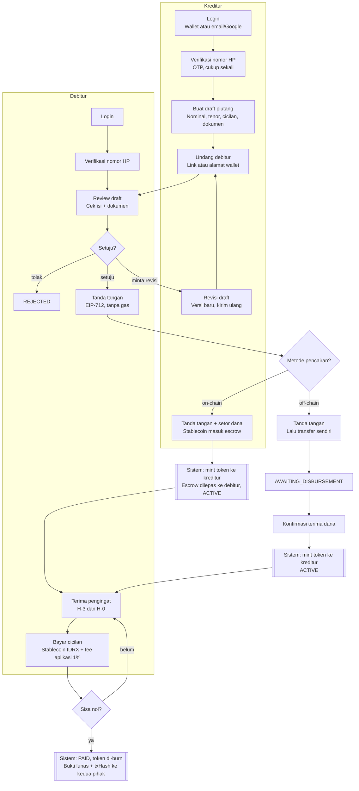

# 02 — User Flow

Flow utama: **kreditur membuat piutang → pencairan on-chain → debitur bayar cicilan sampai lunas.**

## Flow Utama

## Langkah per Tahap

| # | Tahap | Aktor | Status setelahnya |
|---|-------|-------|-------------------|
| 1 | Login + OTP | Keduanya | — |
| 2 | Buat draft | Kreditur | DRAFT |
| 3 | Undang pihak lawan | Kreditur | PENDING_SIGNATURE |
| 4 | Review: setuju / revisi / tolak | Debitur | PENDING_SIGNATURE / DRAFT (versi baru) / REJECTED |
| 5 | Tanda tangan debitur | Debitur | PENDING_SIGNATURE |
| 6 | Tanda tangan + setor escrow | Kreditur | PENDING_SIGNATURE |
| 7 | Mint token + lepas escrow | Sistem | ACTIVE |
| 8 | Pengingat H-3 & H-0 | Sistem | ACTIVE |
| 9 | Bayar cicilan (+ late fee jika terlambat) | Debitur | ACTIVE / OVERDUE |
| 10 | Sisa nol → burn | Sistem | PAID |

## Variasi

- **Debitur membuat draft** (pengajuan utang): kedua lane tinggal ditukar sampai tahap tanda tangan.
- **Pencairan off-chain:** setelah dua tanda tangan (tanpa escrow) status AWAITING_DISBURSEMENT; kreditur mentransfer sendiri, debitur konfirmasi terima dana, lalu token di-mint dan status ACTIVE.
- **Terlambat bayar:** cicilan lewat jatuh tempo → OVERDUE + late fee 2%/bulan (jika disepakati); setelah tunggakan dan late fee dibayar kembali ACTIVE.
- **Dispute:** dari ACTIVE atau OVERDUE, salah satu pihak bisa mengajukan → DISPUTED.
- **Integrity gagal** di tahap mana pun → TAMPERED → FROZEN.
- **Cancel:** pembuat bisa membatalkan selama belum dua signature → CANCELLED. Kreditur juga bisa membatalkan selama AWAITING_DISBURSEMENT.
