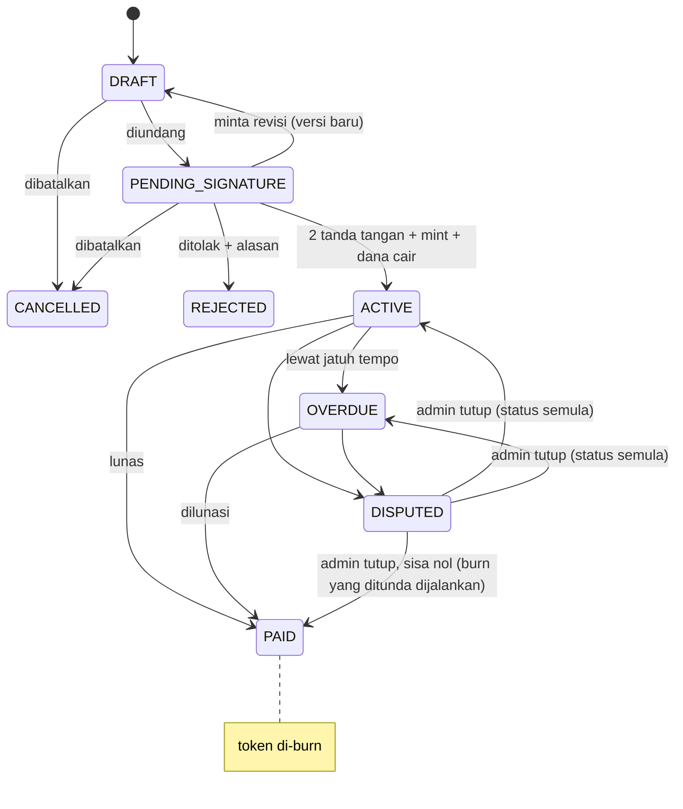

# 03 — Business Rules

## Status Surat Piutang

**FROZEN** bisa terjadi dari status apa pun saat integrity check menghasilkan TAMPERED. Hanya admin yang bisa membukanya setelah data diperbaiki; piutang kembali ke status sebelum di-freeze.

## Akun & Identitas

- **BR-01** Satu wallet hanya terhubung ke satu akun.
- **BR-02** Nomor HP wajib diverifikasi OTP sebelum membuat atau menandatangani piutang.
- **BR-03** Peran (kreditur/debitur) ditentukan **per surat piutang**, bukan per akun.
- **BR-04** Kreditur dan debitur pada satu piutang tidak boleh wallet yang sama.

## Draft & Negosiasi

- **BR-05** Kreditur atau debitur boleh membuat draft.
- **BR-06** Setiap revisi membuat **versi baru**; semua signature versi lama otomatis batal.
- **BR-07** Draft bisa CANCELLED selama belum ditandatangani kedua pihak.
- **BR-08** Penolakan (REJECTED) wajib menyertakan alasan dan bersifat final; piutang baru harus dibuat ulang.

## Tanda Tangan & Tokenisasi

- **BR-09** Signature memakai EIP-712 atas canonical payload (semua field + hash dokumen).
- **BR-10** Signature punya `nonce`, `chainId`, dan `deadline`; signature kedaluwarsa ditolak.
- **BR-11** Token di-mint hanya jika dua signature valid, ke wallet kreditur.
- **BR-12** Hash dokumen yang sudah pernah dipakai ditolak contract (anti double-mint).
- **BR-13** Token **non-transferable** di versi ini.

## Pencairan

- **BR-14** On-chain: kreditur menyetor stablecoin ke escrow saat tanda tangan; dana dilepas ke debitur saat mint.
- **BR-15** Off-chain: piutang ACTIVE setelah debitur mengonfirmasi terima dana.
- **BR-16** Penarikan escrow (permit) dan pelepasan ke debitur terjadi atomik dalam satu tx `mintNote`. Jika piutang batal sebelum mint, permit tidak pernah dieksekusi sehingga dana kreditur tidak berpindah.

## Pembayaran

- **BR-17** Pembayaran on-chain langsung mengurangi sisa utang tanpa input manual.
- **BR-18** Pembayaran off-chain tercatat hanya setelah kreditur konfirmasi dengan signature EIP-712 (`OffchainPayment`, ber-`nonce` dan `deadline`); kreditur boleh menolak dengan alasan.
- **BR-19** Pembayaran sebagian diperbolehkan dan dialokasikan ke cicilan tertua dulu.
- **BR-20** Pembayaran tidak boleh melebihi sisa utang (termasuk late fee).
- **BR-21** Lewat jatuh tempo dan belum lunas → OVERDUE; late fee dihitung hanya jika disepakati di perjanjian.
- **BR-22** Sisa utang nol → PAID, token di-burn, bukti lunas berisi txHash dikirim ke kedua pihak.

## Dispute & Integrity

- **BR-23** Dispute hanya dari ACTIVE atau OVERDUE, wajib alasan dan bukti.
- **BR-24** Saat DISPUTED: pembayaran on-chain tetap diterima; burn dan konfirmasi off-chain ditahan.
- **BR-25** Admin tidak bisa mengubah nominal atau isi perjanjian; perubahan hanya lewat revisi yang ditandatangani ulang kedua pihak.
- **BR-26** Hash DB ≠ hash on-chain → TAMPERED → FROZEN otomatis.
- **BR-27** Piutang FROZEN menolak pembayaran baru, perubahan, dan burn sampai admin membukanya.

## Notifikasi

- **BR-28** Pengingat dikirim H-3 dan H-0 jatuh tempo (email + in-app).
- **BR-29** OVERDUE, setiap pembayaran, dan pelunasan diberitahukan ke kedua pihak.
