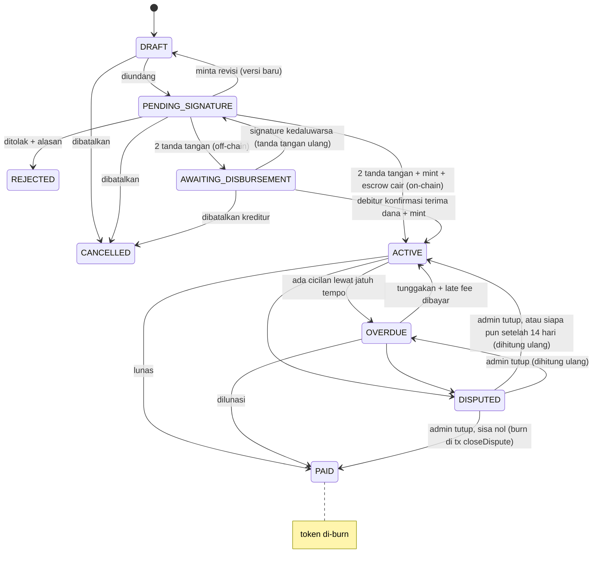

# 03 — Business Rules

## Status Surat Piutang

**FROZEN** bisa terjadi dari status apa pun saat integrity check menghasilkan TAMPERED. Hanya admin yang bisa membukanya setelah data diperbaiki; piutang kembali ke DISPUTED jika sebelumnya DISPUTED, selain itu status dihitung ulang (ACTIVE/OVERDUE/PAID).

- **Sebelum mint** (DRAFT, PENDING_SIGNATURE, AWAITING_DISBURSEMENT): belum ada token, jadi freeze **hanya di DB** (`status_before_freeze` disimpan, job aktivasi yang antre dibatalkan; escrow yang sudah disetor bisa ditarik kreditur dengan `refundEscrow`). Unfreeze mengembalikan status DB sebelumnya; signature yang sudah lewat `deadline` harus ditandatangani ulang.
- **Setelah mint**: freeze di DB **dan** on-chain lewat `freeze(noteId)`; status DB mengikuti event `StatusChanged`.

OVERDUE **tidak disimpan** di contract: `statusOf()` menghitungnya saat dibaca dan tidak ada event. Backend menyinkronkan status OVERDUE ke DB dengan membaca `statusOf()` secara berkala (tanpa transaksi).

`AWAITING_DISBURSEMENT` hanya ada di DB (belum ada token). Status sejak ACTIVE mengikuti contract lewat indexer.

## Akun & Identitas

- **BR-01** Satu wallet hanya terhubung ke satu akun.
- **BR-02** Nomor HP wajib diverifikasi OTP sebelum membuat atau menandatangani piutang.
- **BR-03** Peran (kreditur/debitur) ditentukan **per surat piutang**, bukan per akun.
- **BR-04** Kreditur dan debitur pada satu piutang tidak boleh wallet yang sama.

## Draft & Negosiasi

- **BR-05** Kreditur atau debitur boleh membuat draft.
- **BR-06** Setiap revisi membuat **versi baru**; semua signature versi lama otomatis batal.
- **BR-07** Draft bisa CANCELLED selama belum ditandatangani kedua pihak, atau oleh kreditur selama AWAITING_DISBURSEMENT (belum di-mint).
- **BR-08** Penolakan (REJECTED) wajib menyertakan alasan dan bersifat final; piutang baru harus dibuat ulang.

## Tanda Tangan & Tokenisasi

- **BR-09** Signature memakai EIP-712 atas canonical payload (semua field + hash dokumen).
- **BR-10** Signature punya `nonce` acak (unordered, sekali pakai per signer), `chainId`, dan `deadline`; signature kedaluwarsa atau nonce terpakai ditolak. Banyak piutang dan konfirmasi bayar dari wallet yang sama boleh berjalan paralel.
- **BR-11** Token di-mint hanya jika dua signature valid, ke wallet kreditur.
- **BR-12** Hash dokumen yang sudah pernah dipakai ditolak contract (anti double-mint).
- **BR-13** Token **non-transferable** di versi ini.

## Pencairan

- **BR-14** On-chain: kreditur menyetor stablecoin ke escrow saat tanda tangan; dana dilepas ke debitur saat mint.
- **BR-15** Off-chain: setelah dua tanda tangan, piutang berstatus AWAITING_DISBURSEMENT (hanya di DB). Kreditur mentransfer sendiri; debitur mengonfirmasi terima dana dengan menandatangani `DisbursementReceipt`, lalu relayer memanggil `activateOffchain` (mint) dan piutang menjadi ACTIVE. Jika signature kedaluwarsa (14 hari) sebelum konfirmasi, kedua pihak tanda tangan ulang.
- **BR-16** Escrow dua langkah: saat kreditur tanda tangan, relayer memanggil `depositEscrow` (dana kreditur pindah ke contract lewat permit). Dana baru dilepas ke debitur saat `activateOnchain`. Jika piutang batal sebelum aktif, kreditur menarik dananya dengan `refundEscrow`, yang sekaligus membatalkan signature kreditur. Backend memicu refund otomatis saat draft dibatalkan, ditolak, atau direvisi.

## Pembayaran

- **BR-17** Pembayaran on-chain langsung mengurangi sisa utang tanpa input manual.
- **BR-18** *(Dihapus.)* Pembayaran cicilan hanya lewat stablecoin IDRX on-chain; pembayaran via transfer bank (upload bukti + konfirmasi kreditur) tidak lagi didukung. `recordOffchainPayment` di kontrak tetap ada tapi tidak dipakai aplikasi.
- **BR-19** Pembayaran sebagian diperbolehkan; dialokasikan berurutan: (1) tunggakan cicilan yang sudah jatuh tempo, tertua dulu, (2) late fee, (3) cicilan berikutnya yang belum jatuh tempo.
- **BR-20** Sisa utang = sisa cicilan (pokok + bunga) + late fee berjalan. Pembayaran tidak boleh melebihi sisa utang.
- **BR-21** Ada cicilan lewat jatuh tempo yang belum lunas → OVERDUE (dicek per cicilan, on-chain); kembali ACTIVE setelah tunggakan **dan** late fee dibayar.
- **BR-21a** Late fee **2% per bulan (30 hari)** dari cicilan yang terlambat, pro-rata harian, tidak majemuk, hanya jika disepakati di perjanjian (`lateFeeBps` 0 atau 200). **Tetap bertambah selama DISPUTED** (dispute tidak boleh jadi cara menghentikan denda); hanya **FROZEN** yang menghentikannya. Saat menutup dispute admin boleh menghapus denda yang menumpuk selama periode dispute (`waiveFee`). *(Diubah dari aturan lama "tidak bertambah selama DISPUTED".)*
- **BR-22** Sisa utang nol → PAID, token di-burn, bukti lunas berisi txHash dikirim ke kedua pihak.
- **BR-22a** **Fee aplikasi**: setiap pembayaran **on-chain (IDRX)** oleh debitur dikenai fee `APP_FEE_BPS` basis poin dari nominal yang benar-benar terbayar (default **100 = 1%**, maks 1000 = 10%), dibulatkan ke atas, dan ditarik ke `APP_FEE_WALLET`. Fee **ditambahkan di atas** cicilan (kreditur tetap menerima nominal penuh), jadi saldo debitur harus cukup untuk cicilan + fee. Gas tetap ditanggung relayer. `APP_FEE_WALLET` kosong atau `APP_FEE_BPS=0` = fee nonaktif.

## Dispute & Integrity

- **BR-23** Dispute hanya dari ACTIVE atau OVERDUE, wajib alasan dan bukti.
- **BR-24** Saat DISPUTED: pembayaran on-chain tetap diterima; burn dan konfirmasi off-chain ditahan. Dispute dibuka on-chain oleh kreditur/debitur (`openDispute`) dan ditutup admin (`closeDispute(noteId, resolutionHash, waiveFee)`); jika admin tidak bertindak dalam `DISPUTE_WINDOW` (14 hari), siapa pun boleh menutupnya (`closeExpiredDispute`, tanpa waive). Dispute kedua pada piutang yang sama boleh dan tidak mereset denda yang sudah ada. Jika sisa utang nol, PAID + burn terjadi di tx penutupan itu.
- **BR-25** Admin tidak bisa mengubah nominal atau isi perjanjian; perubahan hanya lewat revisi yang ditandatangani ulang kedua pihak.
- **BR-26** Hash DB ≠ hash on-chain → TAMPERED → FROZEN otomatis.
- **BR-27** Piutang FROZEN menolak pembayaran baru, perubahan, dan burn sampai admin membukanya.

## Notifikasi

- **BR-28** Pengingat dikirim H-3 dan H-0 jatuh tempo (email + in-app).
- **BR-29** OVERDUE, setiap pembayaran, dan pelunasan diberitahukan ke kedua pihak.
