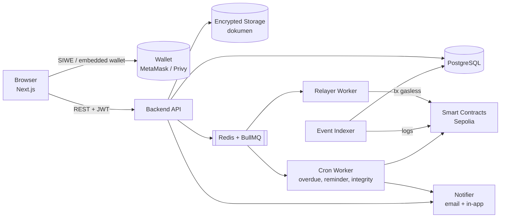
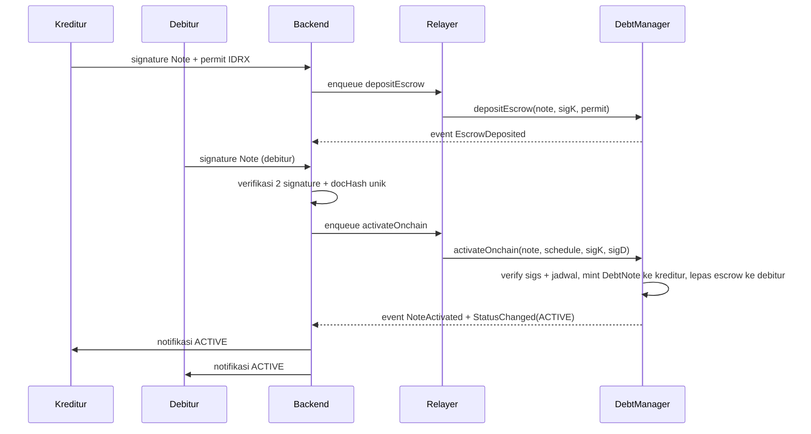

# 06 — Architecture

## Diagram Komponen

## Komponen

| Komponen | Tanggung jawab |
|----------|----------------|
| **Frontend** | UI draft, review, tanda tangan EIP-712, upload, dashboard piutang |
| **Backend API** | Auth SIWE, CRUD draft, verifikasi signature, otorisasi per piutang, audit log |
| **Storage** | Menyimpan dokumen terenkripsi; hanya hash yang keluar |
| **Relayer Worker** | Mengirim tx memakai ethers `Wallet` + `NonceManager`, retry: `depositEscrow`, `activateOnchain`/`activateOffchain`, `recordOffchainPayment`, `amend`, dan `PiutangForwarder.execute` untuk aksi pengguna (bayar, dispute, markPaid, refund). Satu-satunya pengirim tx dari wallet relayer |
| **Event Indexer** | Membaca event `DebtManager` lewat ethers `contract.queryFilter` (`NoteActivated`, `PaymentRecorded`, `LateFeeAccrued`, `NoteSettled`, `StatusChanged`, `DisputeOpened/Closed`, `NoteFrozen/Unfrozen`, `EscrowDeposited/Refunded`) → update DB via Prisma secara idempotent |
| **Cron Worker** | Baca `statusOf()`/`remaining()` untuk sinkron OVERDUE dan denda ke DB (OVERDUE dihitung contract, tanpa event dan tanpa tx), kirim pengingat H-3/H-0, integrity check berkala |
| **Integrity Checker** | Hitung ulang `docHash` dari DB → `verifyHash()`, bandingkan field nominal dengan `getNote()` → VERIFIED / TAMPERED. Saat TAMPERED memanggil `freeze` dengan key `FREEZER_ROLE` |
| **Smart Contracts** | `DebtManager` (escrow, aktivasi, pembayaran, denda, dispute, freeze), `DebtNote` (ERC-721 non-transferable), `MockIDRX` (ERC-20 + permit), `PiutangForwarder` (ERC-2771) |

## Alur Data: Tanda Tangan → Aktif (pencairan on-chain)

Urutan tanda tangan boleh terbalik (debitur dulu). Untuk pencairan **off-chain** tidak ada escrow: setelah dua signature, status DB `AWAITING_DISBURSEMENT`; debitur menandatangani `DisbursementReceipt`, lalu relayer memanggil `activateOffchain`. Jika piutang batal sebelum aktif, backend mengirim `refundEscrow` (lewat forwarder, ditandatangani kreditur).

## Prinsip

- **Source of truth isi perjanjian:** DB (off-chain), dikunci oleh hash on-chain.
- **Source of truth saldo, late fee & status token:** contract; DB adalah cache hasil indexer. Backend tidak mengubah status ACTIVE/OVERDUE/PAID sendiri: ACTIVE/PAID/DISPUTED/FROZEN dari event `StatusChanged`, OVERDUE dari `statusOf()`.
- **Idempotency:** setiap event diproses berdasarkan `(txHash, logIndex)` unik.
- **Gasless:** pengguna hanya menandatangani pesan; semua tx dikirim relayer (langsung atau lewat `PiutangForwarder`).
