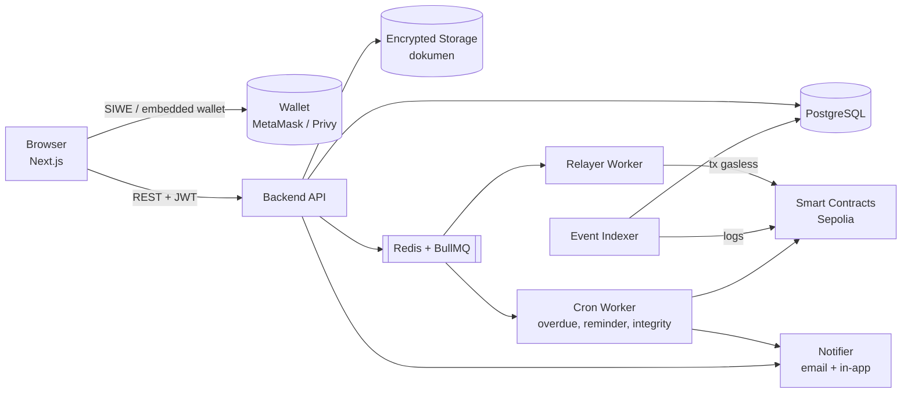
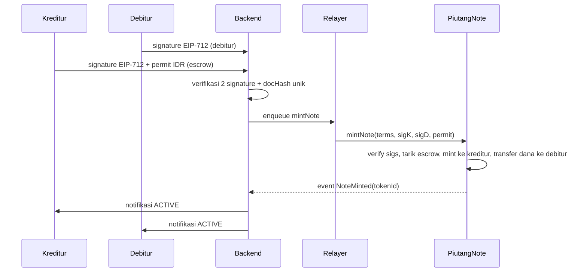

# 06 — Architecture

## Diagram Komponen

## Komponen

| Komponen | Tanggung jawab |
|----------|----------------|
| **Frontend** | UI draft, review, tanda tangan EIP-712, upload, dashboard piutang |
| **Backend API** | Auth SIWE, CRUD draft, verifikasi signature, otorisasi per piutang, audit log |
| **Storage** | Menyimpan dokumen terenkripsi; hanya hash yang keluar |
| **Relayer Worker** | Mengirim tx (mint, `Forwarder.execute` untuk repay, confirm, overdue, faucet) memakai ethers `Wallet` + `NonceManager`, retry. Satu-satunya pengirim tx dari wallet relayer |
| **Event Indexer** | Membaca event contract lewat ethers `contract.queryFilter` (`NoteMinted`, `Repaid`, `LateFeeAccrued`, `NoteBurned`, `StatusChanged`) → update DB via Prisma secara idempotent |
| **Cron Worker** | Antrekan `markOverdue` ke Relayer Worker untuk cicilan yang baru lewat jatuh tempo (status DB mengikuti event), kirim pengingat H-3/H-0, integrity check berkala |
| **Integrity Checker** | Hitung ulang hash dari DB, bandingkan dengan on-chain → VERIFIED / TAMPERED |
| **Smart Contracts** | `PiutangNote` (ERC-721 + escrow + repayment), `MockIDR` (ERC-20 + permit), `Forwarder` (ERC-2771) |

## Alur Data: Tanda Tangan → Mint

Untuk pencairan **off-chain**, langkah `enqueue mintNote` baru dijalankan setelah debitur memanggil `confirm-disbursement`; tanpa permit dan tanpa transfer dana di contract.

## Prinsip

- **Source of truth isi perjanjian:** DB (off-chain), dikunci oleh hash on-chain.
- **Source of truth saldo, late fee & status token:** contract; DB adalah cache hasil indexer. Backend tidak mengubah status ACTIVE/OVERDUE/PAID sendiri.
- **Idempotency:** setiap event diproses berdasarkan `(txHash, logIndex)` unik.
- **Gasless:** pengguna hanya menandatangani pesan; semua tx dikirim relayer.
