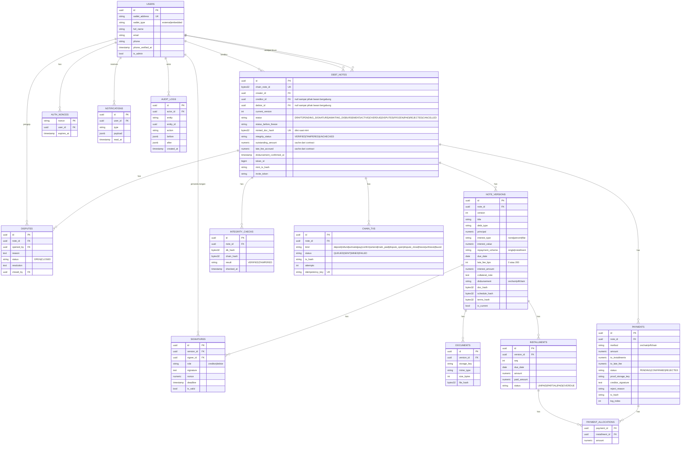

# 07 — Entity Relationship Diagram

## Catatan

- `NOTE_VERSIONS` immutable: revisi = baris baru, `is_current` dipindah. `doc_hash` **tidak** unik di tabel ini karena revisi yang hanya mengubah jadwal memakai dokumen yang sama.
- Anti double-mint di DB: `DEBT_NOTES.minted_doc_hash` unik, diisi dari versi yang di-mint (cermin `usedDocHash` di contract).
- Burn terjadi di dalam tx pembayaran/konfirmasi/`markPaid` (atau saat dispute ditutup / unfreeze), jadi tidak ada `kind` burn terpisah di `CHAIN_TXS`.
- `DEBT_NOTES.token_id` = `uint256(chain_note_id)`.
- `PAYMENTS (tx_hash, log_index)` unik untuk idempotency event on-chain.
- `DEBT_NOTES.status` ACTIVE/PAID/DISPUTED/FROZEN diperbarui indexer dari `StatusChanged`; OVERDUE disinkronkan cron dengan membaca `statusOf()` (contract tidak memancarkan event untuk OVERDUE). `INSTALLMENTS.paid_amount` diturunkan dari `scheduledPaid` di `getNote()` (alokasi tertua dulu) setelah event `PaymentRecorded`.
- `AUDIT_LOGS` append-only (tanpa UPDATE/DELETE lewat RLS atau trigger).
